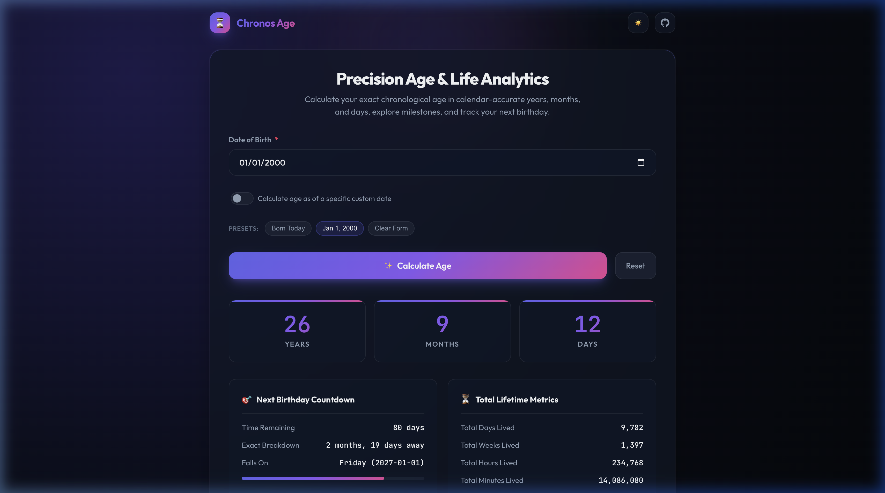
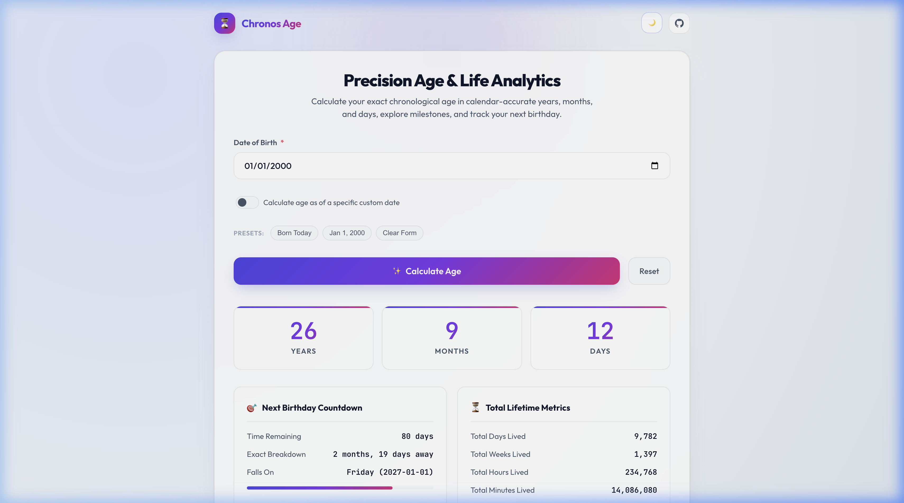
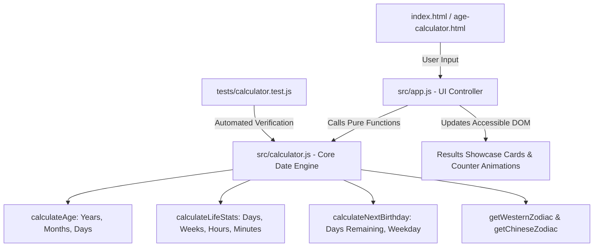

# ⏳ Precision Age Calculator & Life Analytics

[](https://github.com/vanimendiratta/Age-Calculator/actions)
[](LICENSE)
[](package.json)
[](tests/calculator.test.js)
[](index.html)

A high-performance, calendar-accurate chronological age calculation engine and interactive life statistics dashboard built with modern vanilla web technologies and zero runtime dependencies.

---

## 📸 Screenshots

| Dark Mode (Default) | Light Mode |
| :---: | :---: |
|  |  |

---

## 🌟 Why This Project?

Calculating age seems deceptively simple, but naive implementations (`now.getFullYear() - dob.getFullYear()`) frequently produce wrong answers:
- **Calendar Boundary Errors:** They ignore whether the user's birth month and day have already arrived in the current year.
- **Timezone Drift:** Parsing `new Date("YYYY-MM-DD")` treats dates as UTC midnight, producing off-by-one day errors across western timezones.
- **Leap Year Edge Cases:** Handling leap days (February 29) across century non-leap years (1900, 2100) and quad-century leap years (2000, 2400) requires calendar arithmetic.
- **Month Borrowing:** Different months have 28, 29, 30, or 31 days, requiring calendar-aware borrowing when computing days.

**Precision Age Calculator** solves all of these edge cases with an isolated, functional calculation engine verified by 34 automated unit tests.

### 📅 February 29 (Leap Day) Calculation Standard
For individuals born on February 29 during a leap year:
- **Common (Non-Leap) Years:** February 29 does not occur. On February 28, exactly 364 days have elapsed (`0 years, 11 months, 30 days`). On **March 1**, exactly 365 days have elapsed, completing the full anniversary year (`1 year, 0 months, 0 days`). This follows English common law precedent and civil majority statutes.
- **Leap Years:** On February 29, their calendar anniversary occurs (`isTodayBirthday: true`).
- **Next Birthday Countdown:** In common years, the countdown targets **March 1**; in leap years, it targets **February 29**.

---

## ✨ Features

- 🎯 **Calendar-Accurate Chronological Age:** Exact breakdown in **Years, Months, and Days** with leap year handling and month borrowing.
- ⏳ **Next Birthday Countdown:** Real-time countdown in days, detailed months/days remaining, weekday resolution, and an annual visual progress bar.
- 📊 **Lifetime Metric Suite:** Total days, weeks, hours, and minutes lived.
- 💓 **Physiological Estimates:** Heartbeat (~72 bpm) and breath (~16 bpm) estimates computed from total lifetime minutes.
- 🌟 **Astrological & Cultural Dossier:** Western Zodiac sign with symbols and date ranges, Chinese Zodiac lunar animal, and day of the week born.
- 🗓️ **Target Date Mode:** Calculate age as of any custom past or future date (e.g., "How old will I be on July 4, 2030?").
- 🎨 **Glassmorphic Design System:** Fluid typography, glowing gradients, animated number counters, and responsive CSS Grid/Flexbox.
- 🌓 **Theme Management:** Dark and Light mode with persistent storage and system preference detection.
- ♿ **WCAG 2.1 AA Accessible:** Explicit label bindings, ARIA live regions (`role="alert"`), visible focus states, and keyboard submission (`Enter` key).
- 📋 **One-Click Share:** Copy a formatted summary to clipboard with instant feedback.
- 🚀 **Zero Runtime Dependencies:** Pure HTML5, CSS3, and ES6+ modules with no build step required.

---

## 🏗️ Architecture

The codebase enforces strict separation of concerns between pure mathematical business logic and presentation:



### File Structure

```
├── .github/
│   └── workflows/
│       └── ci.yml              # GitHub Actions CI matrix (Node 18, 20, 22)
├── docs/
│   ├── images/
│   │   ├── screenshot-dark.png # Application UI in dark theme
│   │   └── screenshot-light.png# Application UI in light theme
│   ├── PROJECT_AUDIT.md        # Comprehensive technical audit & vulnerability report
│   └── IMPLEMENTATION_PLAN.md  # Engineering upgrade task roadmap
├── src/
│   ├── calculator.js           # Pure functional date & calendar calculation engine
│   └── app.js                  # DOM controller, theme toggle, and animations
├── tests/
│   └── calculator.test.js      # 25 automated unit tests with node:test
├── age-calculator.css          # Design system, CSS tokens, glassmorphism
├── age-calculator.html         # Accessible HTML structure (legacy entry)
├── age-calculator.js           # Backward-compatible ES module export
├── index.html                  # Primary modern entry point (SEO optimized)
├── package.json                # Project manifest & test runner configuration
├── .editorconfig               # Cross-platform editor formatting standards
├── .gitignore                  # Git exclusions for node, logs, and OS caches
├── CHANGELOG.md                # Semantic versioning history
├── CONTRIBUTING.md             # Contribution guidelines
├── CODE_OF_CONDUCT.md          # Contributor Covenant Code of Conduct
├── SECURITY.md                 # Security vulnerability reporting policy
├── LICENSE                     # MIT License
└── README.md                   # Project documentation
```

---

## 🚀 Quick Start

### Prerequisites
- [Node.js](https://nodejs.org/) v18.0.0 or higher (for test runner)
- Any modern web browser

### 1. Clone the Repository
```bash
git clone https://github.com/vanimendiratta/Age-Calculator.git
cd Age-Calculator
```

### 2. Run Automated Tests
Execute the built-in Node test suite:
```bash
npm test
```

### 3. Launch the Application Locally
Because this project uses zero runtime dependencies, you can open `index.html` directly or serve via any static web server:
```bash
# Using Python
python3 -m http.server 3000

# Or using Node / npx
npm start
```
Visit `http://localhost:3000` in your browser.

---

## 🧪 Testing & Verification

The test suite validates core mathematical invariants and calendar edge cases without external mocking dependencies:

```bash
> npm test

▶ parseLocalDate
  ✔ parses valid YYYY-MM-DD strings without UTC timezone drift
  ✔ normalizes Date object instances with arbitrary times to local midnight
  ✔ rejects non-existent calendar dates like February 31
  ✔ rejects February 29 in non-leap years
  ✔ accepts February 29 in valid leap years
  ✔ rejects 31st day on 30-day months (April, June, September, November)
  ✔ rejects invalid input types and formats
▶ isLeapYear
  ✔ identifies standard leap years divisible by 4
  ✔ identifies century non-leap years (1900, 2100)
  ✔ identifies 400-year century leap years (2000, 2400)
  ✔ identifies standard non-leap years
▶ calculateAge — Core & Leap Day Rules
  ✔ calculates exact age when birthday has not occurred yet this year
  ✔ calculates exact age when birthday is today
  ✔ handles February 29 birthday on non-leap year Feb 28 (364 days lived)
  ✔ handles February 29 birthday on non-leap year March 1 (365 days lived)
  ✔ handles February 29 birthday on subsequent leap year anniversary (Feb 29, 2004)
  ✔ handles month-end boundaries: Jan 31 to Feb 28 in common year (2023)
  ✔ handles month-end boundaries: Jan 31 to Feb 29 in leap year (2024)
  ✔ handles month-end boundaries: March 31 to April 30
  ✔ handles month-end boundaries: May 31 to November 30
  ✔ handles same-day birth (0 days old)
  ✔ rejects future dates with an informative error
▶ calculateLifeStats
  ✔ calculates exact days and time breakdown for 1 common year
  ✔ accurately includes 366 days across a leap year
  ✔ returns null for future dates
▶ calculateNextBirthday
  ✔ correctly identifies when birthday is today
  ✔ calculates days remaining when birthday is later this year
  ✔ rolls over to next calendar year when birthday has already passed
  ✔ handles leap year Feb 29 birth in non-leap reference year (schedules for March 1)
  ✔ handles leap year Feb 29 birth in a leap reference year (schedules for Feb 29)
▶ getWesternZodiac
  ✔ determines correct zodiac signs across boundaries
▶ getChineseZodiac
  ✔ determines correct Chinese zodiac animal
▶ getDayOfWeekBorn
  ✔ returns correct weekday name
▶ calculateCompleteDossier
  ✔ assembles complete data structure seamlessly

ℹ tests 34
ℹ suites 9
ℹ pass 34
ℹ fail 0
```

---

## 💻 Programmatic Usage

The calculation engine in `src/calculator.js` is fully decoupled and can be imported into any JavaScript or TypeScript project:

```javascript
import { calculateAge, calculateLifeStats, calculateCompleteDossier } from './src/calculator.js';

// Calculate exact chronological age
const age = calculateAge('2000-12-31', '2026-01-01');
console.log(age);
// Output: { isValid: true, error: null, years: 25, months: 0, days: 1, isTodayBirthday: false }

// Full life dossier
const dossier = calculateCompleteDossier('1995-10-13');
console.log(dossier.westernZodiac); // { name: 'Libra', symbol: '♎', ... }
console.log(dossier.lifeStats.totalDays); // 11,324
```

---

## 🗺️ Roadmap

- [ ] Export age dossier as downloadable PDF / Shareable image card
- [ ] Planetary Age Calculator (calculate age on Mars, Venus, Jupiter)
- [ ] Multi-person age difference comparison tool
- [ ] Internationalization (i18n) for multiple languages

---

## 🤝 Contributing

Contributions, bug reports, and suggestions are welcome! Please check out [CONTRIBUTING.md](CONTRIBUTING.md) for details on setting up your environment and submitting pull requests.

---

## 📄 License

Distributed under the MIT License. See [LICENSE](LICENSE) for more information.

---

## 👩‍💻 Author

**Vani Mendiratta**  
- GitHub: [@vanimendiratta](https://github.com/vanimendiratta)