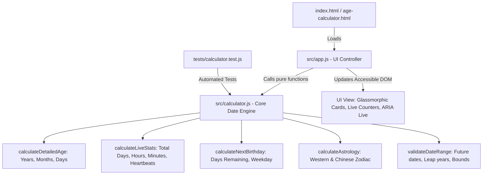

# Engineering Audit & Technical Assessment: Age Calculator

**Repository:** `vanimendiratta/Age-Calculator`  
**Audit Date:** October 13, 2026  
**Auditor:** Senior Software Engineer & Security/QA Architect  
**Environment:** Client-Side Web Application  

---

## 1. Executive Summary & Project Purpose

The **Age Calculator** is a client-side web application designed to calculate a user's chronological age from a selected Date of Birth (DOB). While the initial prototype established a basic proof-of-concept with HTML, CSS, and JavaScript, the repository suffered from severe mathematical and date-parsing bugs, total absence of tests, rigid non-responsive layout constraints, and a complete lack of modern development tooling or documentation.

This audit evaluates the codebase across correctness, architecture, security, performance, accessibility, testing, and portfolio presentation, followed by a concrete engineering upgrade roadmap.

---

## 2. Verified Technology Stack

| Layer | Original State | Target Production State |
| :--- | :--- | :--- |
| **Runtime / Platform** | Pure Browser (vanilla client-side) | Modern Browser ES6+ Modules (Zero runtime dependencies) |
| **Markup (Structure)** | Basic HTML5 (`age-calculator.html`) | Semantic, accessible HTML5 (`index.html` & `age-calculator.html`) |
| **Styling** | Vanilla CSS (`age-calculator.css`) | Modern Vanilla CSS3 Design System with CSS variables, Glassmorphism, Dark/Light modes, fluid responsive design |
| **Business Logic** | Unstructured script (`age-calculator.js`) | Modular Functional Engine (`src/calculator.js`, `src/app.js`) with separation of concerns |
| **Test Runner** | None | Node.js built-in `node:test` + test assertion suite (zero dev lock-in, reproducible in CI) |
| **Tooling & CI** | None (no `package.json`, `.gitignore`) | `package.json`, ESLint, Prettier, GitHub Actions CI workflow |
| **Documentation** | 1-line `README.md` | Comprehensive README with architecture diagrams, badges, manual, contributing, security, and license |

---

## 3. Architecture & Execution Flow

### Original Flow
```
User selects date -> Clicks button -> alert() if empty -> now_year - dob_year -> innerHTML = "Your age is X"
```
*Deficiencies:* 
- Pure subtraction of year values (`2026 - 2000 = 26`) completely fails if the birthday has not yet occurred in the current calendar year.
- Direct invocation of `new Date("YYYY-MM-DD")` triggers ISO 8601 UTC parsing in JavaScript, which causes off-by-one day bugs across western timezones.
- Business logic is tightly coupled to DOM queries, making automated testing impossible without browser mock harnesses.

### Target Architecture


---

## 4. Prioritized Audit Findings

### P0 — Critical Correctness & Security Issues
1. **Flawed Mathematical Calculation (Incorrect Age Logic):**  
   - `const age = now_year - dob_year;` ignores month and day boundaries. If DOB is `2000-12-31` and today is `2026-01-01`, age is reported as 26 instead of 25 years and 1 day.
2. **UTC Timezone Off-by-One Parsing Bug:**  
   - In JavaScript, `new Date("2000-05-15")` is treated as midnight UTC. In negative UTC offsets (e.g. EST/PST), `dob.getDate()` or `dob.getFullYear()` can return the previous day/year.
3. **Unhandled Future and Invalid Dates:**  
   - Selecting a date in the future (e.g. 2030) outputs negative numbers (`Your age is -4`). Entering invalid values yields `NaN`.
4. **Thread-Blocking Alert System:**  
   - Calling native `alert()` disrupts the user experience, freezes UI animations, and lacks modern error styling.

### P1 — High-Impact Quality & Accessibility Issues
1. **Zero Automated Testing:**  
   - No unit or regression tests. Edge cases (leap years like Feb 29, month boundaries with 28/29/30/31 days, same-day birth, timezone drift) are completely unguarded.
2. **Layout Breakage & Non-Responsive Design:**  
   - `.age-container` had hardcoded `width: 500px; height: 250px;`. On mobile viewports (<500px) or when richer content is displayed, the container overflows and clips content.
3. **Accessibility Violations (WCAG 2.1 AA):**  
   - `<label>` lacks `for` attribute and `<input>` lacks `id`.
   - Results are injected without an `aria-live="polite"` region, leaving screen readers unaware of calculated results.
   - Missing keyboard accessibility (form submission on pressing `Enter` key is not supported).

### P2 — Meaningful Architecture & Usability Improvements
1. **Tight Coupling between UI and Calculation Engine:**  
   - Logic must be extracted into a pure, testable ES module (`src/calculator.js`).
2. **Minimal Feature Scope (Recruiter & Portfolio Gap):**  
   - Modern users expect an exact breakdown (e.g., "25 years, 4 months, 12 days"), countdown to the next birthday, total lifetime statistics (days, hours, minutes lived), day of the week born, and zodiac signs.
3. **Absence of Standard Engineering Tooling:**  
   - No `package.json`, `.gitignore`, linter, formatter, or CI pipeline.

### P3 — Repository Polish & Documentation
1. **Missing Portfolio Documentation:**  
   - Single-line README provides zero context to hiring managers, recruiters, or open-source contributors.
2. **Missing Repository Governance Files:**  
   - Lack of `LICENSE` (MIT), `CONTRIBUTING.md`, `SECURITY.md`, and `CHANGELOG.md`.

---

## 5. Proposed Advancements
1. **Accurate Date Computation Engine:**  
   - Full support for Gregorian calendar rules, leap years (February 29 in leap vs non-leap years), differing month lengths (28, 29, 30, 31 days), and precise day differences.
2. **Rich Life Analytics:**  
   - Age breakdown: Years, Months, Days.
   - Lifetime Milestones: Total days, weeks, hours, minutes lived.
   - Next Birthday Countdown: Days and months remaining, day of the week.
   - Day of birth discovery and Western/Chinese Zodiac signs.
   - Target Date Mode: Calculate age as of an arbitrary past or future date.
3. **Premium Visual Design:**  
   - Modern Glassmorphism aesthetic, sleek dark/light theme toggle, fluid CSS grid/flexbox, Google Fonts (`Outfit`), animated result counters, accessible focus states.
4. **Production Tooling:**  
   - Node-based test runner (`node:test` suite), zero runtime bloat, GitHub Actions CI workflow, `.gitignore`, and full documentation.
